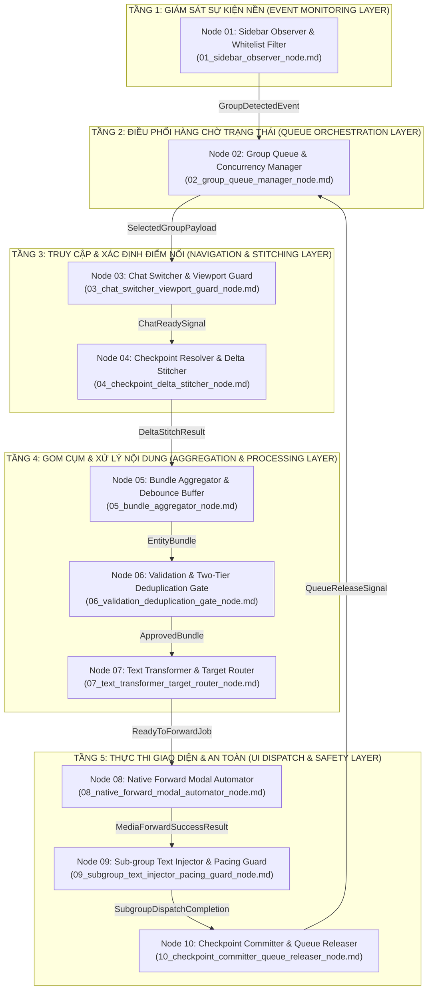
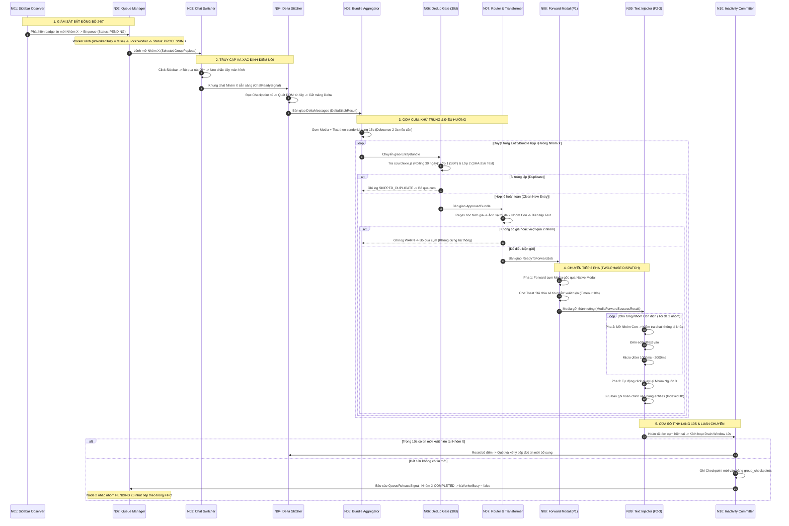
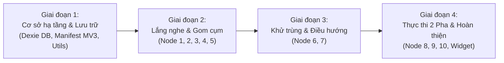

# TỔNG MỤC ĐẶC TẢ KIẾN TRÚC NODE & HƯỚNG DẪN TRIỂN KHAI HỆ THỐNG
**Dự án**: Hệ thống Tự Động Hóa Thu Thập, Biên Tập & Phân Phối Tin Nhắn Zalo Đa Nhóm (Personal Account 24/7)  
**Nền tảng**: Zalo Web (`chat.zalo.me`) — Chromium Extension Manifest V3 + TypeScript + IndexedDB (Dexie.js)  
**Thư mục lưu trữ tài liệu**: `c:\Users\ADMIN\Documents\workspace\Sales\EXTENSIONS\Docs\Start-node\`  
**Phiên bản đặc tả**: 2.1 (Official Modular Node Architecture Baseline)  
**Ngày cập nhật**: 11/11/2026  

---

## 1. TỔNG QUAN KIẾN TRÚC PHÂN TẦNG (5-LAYER ARCHITECTURE)

Hệ thống được bóc tách triệt để thành **5 tầng chức năng độc lập** với **10 Node chuyên trách**. Mỗi tầng chỉ giao tiếp với tầng kế tiếp thông qua các hợp đồng dữ liệu chuẩn hóa (Data Contracts), loại bỏ hoàn toàn sự phụ thuộc chéo và đảm bảo khả năng tự phục hồi 24/7:



---

## 2. BẢNG CHỈ MỤC CÁC TÀI LIỆU ĐẶC TẢ NODE (NODE SPECIFICATION INDEX)

Toàn bộ 10 tài liệu đặc tả chi tiết đã được biên soạn độc lập và chuẩn hóa tại thư mục `Docs/Start-node/`:

| STT | Mã Node | Tên Node Chức Năng | Tầng Kiến Trúc | Tệp Đặc Tả Kỹ Thuật | Nhiệm Vụ Nghiệp Vụ Cốt Lõi |
| :---: | :--- | :--- | :--- | :--- | :--- |
| **01** | `N01_SIDEBAR_OBSERVER` | **Sidebar Observer & Whitelist Filter** | Tầng 1: Event Monitoring | [`01_sidebar_observer_node.md`](file:///c:/Users/ADMIN/Documents/workspace/Sales/EXTENSIONS/Docs/Start-node/01_sidebar_observer_node.md) | Lắng nghe song song bất đồng bộ trên `#conversationList`, nhận diện badge đỏ/preview tin mới, lọc theo danh sách Whitelist động. |
| **02** | `N02_QUEUE_MANAGER` | **Group Queue & Concurrency Manager** | Tầng 2: Queue Orchestration | [`02_group_queue_manager_node.md`](file:///c:/Users/ADMIN/Documents/workspace/Sales/EXTENSIONS/Docs/Start-node/02_group_queue_manager_node.md) | Quản lý hàng đợi FIFO trong IndexedDB, điều phối Mutex Lock đơn luồng Worker, phục hồi sau F5/Crash (Persistent Recovery). |
| **03** | `N03_CHAT_SWITCHER` | **Chat Switcher & Viewport Guard** | Tầng 3: Navigation & Stitching | [`03_chat_switcher_viewport_guard_node.md`](file:///c:/Users/ADMIN/Documents/workspace/Sales/EXTENSIONS/Docs/Start-node/03_chat_switcher_viewport_guard_node.md) | Mở nhóm nguồn, kiểm tra header, **tuyệt đối bỏ qua nút 99+**, neo chắc vị trí đáy màn hình (Strict Bottom Anchor). |
| **04** | `N04_DELTA_STITCHER` | **Checkpoint Resolver & Delta Stitcher** | Tầng 3: Navigation & Stitching | [`04_checkpoint_delta_stitcher_node.md`](file:///c:/Users/ADMIN/Documents/workspace/Sales/EXTENSIONS/Docs/Start-node/04_checkpoint_delta_stitcher_node.md) | Quét DOM từ đáy lên tìm Điểm Nối Checkpoint, cắt lát tập Delta; kích hoạt Fallback 5–10 tin đáy an toàn khi trôi điểm nối. |
| **05** | `N05_BUNDLE_AGGREGATOR` | **Bundle Aggregator & Debounce Buffer** | Tầng 4: Aggregation & Processing | [`05_bundle_aggregator_node.md`](file:///c:/Users/ADMIN/Documents/workspace/Sales/EXTENSIONS/Docs/Start-node/05_bundle_aggregator_node.md) | Gom cụm Media (Ảnh/Album/Video) + Text trong cửa sổ 15s theo người gửi; đệm micro-debounce 2-3s; thẩm định cấu trúc tối thiểu. |
| **06** | `N06_DEDUPLICATION_GATE` | **Validation & Two-Tier Deduplication Gate** | Tầng 4: Aggregation & Processing | [`06_validation_deduplication_gate_node.md`](file:///c:/Users/ADMIN/Documents/workspace/Sales/EXTENSIONS/Docs/Start-node/06_validation_deduplication_gate_node.md) | Khử trùng lặp 2 lớp trong cửa sổ trượt 30 ngày (Rolling 30-Day Window) theo `entityKey` (SĐT/mã căn) và `contentHash` (SHA-256). |
| **07** | `N07_ROUTER_TRANSFORMER` | **Text Transformer & Target Router** | Tầng 4: Aggregation & Processing | [`07_text_transformer_target_router_node.md`](file:///c:/Users/ADMIN/Documents/workspace/Sales/EXTENSIONS/Docs/Start-node/07_text_transformer_target_router_node.md) | Bóc tách giá tiếng Việt (Regex), ánh xạ tối đa 2 Nhóm Con theo khoảng giá, biên tập nội dung theo template, xử lý ngoại lệ chống treo. |
| **08** | `N08_FORWARD_AUTOMATOR` | **Native Forward Modal Automator (Pha 1)** | Tầng 5: UI Dispatch & Safety | [`08_native_forward_modal_automator_node.md`](file:///c:/Users/ADMIN/Documents/workspace/Sales/EXTENSIONS/Docs/Start-node/08_native_forward_modal_automator_node.md) | Mở modal chia sẻ native Zalo, tìm và tích chọn tối đa 2 nhóm con, gửi media gốc, kiểm tra Toast "Đã chia sẻ tin nhắn" (Timeout 10s). |
| **09** | `N09_TEXT_INJECTOR_SAFETY` | **Sub-group Text Injector & Pacing Guard (Pha 2 & 3)** | Tầng 5: UI Dispatch & Safety | [`09_subgroup_text_injector_pacing_guard_node.md`](file:///c:/Users/ADMIN/Documents/workspace/Sales/EXTENSIONS/Docs/Start-node/09_subgroup_text_injector_pacing_guard_node.md) | Chuyển sang từng nhóm con điền text vào `#chat-input`, micro-jitter 1000-2000ms, tự quay lại nhóm nguồn, giám sát Circuit Breaker. |
| **10** | `N10_COMMITTER_RELEASER` | **Checkpoint Committer & Queue Releaser** | Tầng 5: UI Dispatch & Safety | [`10_checkpoint_committer_queue_releaser_node.md`](file:///c:/Users/ADMIN/Documents/workspace/Sales/EXTENSIONS/Docs/Start-node/10_checkpoint_committer_queue_releaser_node.md) | Quản lý đệm tĩnh lặng 10s Inactivity Drain (Safety Cap 5 cycles), cam kết Checkpoint mới vào DB, mở khóa Mutex Lock cho Node 2. |

---

## 3. SƠ ĐỒ TƯƠNG TÁC TUẦN TỰ TOÀN HỆ THỐNG (END-TO-END SEQUENCE DIAGRAM)



---

## 4. HỢP ĐỒNG CƠ SỞ DỮ LIỆU DÙNG CHUNG (INDEXEDDB SCHEMA — DEXIE.JS)

Toàn bộ hệ thống giao tiếp bền vững thông qua cơ sở dữ liệu IndexedDB mang tên `ZaloAutomationDB` tại origin `https://chat.zalo.me`:

```typescript
import Dexie, { Table } from 'dexie';

export interface AppSetting {
  key: string;                 // Khóa cấu hình (whitelist_groups, price_mapping, etc.)
  value: any;
  updatedAt: number;
}

export interface GroupCheckpoint {
  groupId: string;             // ID nhóm nguồn
  groupName: string;           // Tên nhóm nguồn
  lastMsgId: string;           // ID của tin nhắn cuối cùng đã xử lý
  lastMsgHash: string;         // SHA-256 chuỗi văn bản của tin nhắn cuối
  lastMsgTimestamp: number;    // Thời gian của tin nhắn cuối
  updatedAt: number;
}

export interface GroupDispatchItem {
  groupId: string;             // ID nhóm nguồn
  groupName: string;           // Tên nhóm nguồn
  status: 'PENDING' | 'PROCESSING' | 'COMPLETED' | 'FAILED';
  queuedAt: number;            // Thời điểm đưa vào hàng chờ
  lastActiveAt: number;        // Thời điểm tin mới nhất phát sinh
  retryCount: number;          // Đếm số lần thử lại sau crash
  failReason?: string;
}

export interface EntityRecord {
  id?: number;
  entityKey: string;           // SĐT hoặc SĐT_MãCăn (dùng cho deduplication Lớp 1)
  contentHash: string;         // SHA-256 văn bản chuẩn hóa (dùng cho deduplication Lớp 2)
  sourceGroupId: string;       // ID nhóm nguồn
  sourceGroupName: string;
  primaryPhone?: string;       // Số điện thoại trích xuất
  priceNumber?: number;        // Giá số nguyên VNĐ
  rawText: string;             // Text gốc
  editedText: string;          // Text đã biên tập
  targetGroupNames: string[];  // Danh sách các nhóm con đã nhận bài (tối đa 2)
  createdAt: number;           // Mốc thời gian phục vụ lọc Rolling 30 ngày
}

export interface SystemLog {
  id?: number;
  level: 'INFO' | 'WARN' | 'ERROR' | 'CRITICAL';
  eventType: string;           // Mã sự kiện chuẩn hóa
  details: string;
  timestamp: number;
}

export class ZaloAutomationDatabase extends Dexie {
  app_settings!: Table<AppSetting, string>;
  group_checkpoints!: Table<GroupCheckpoint, string>;
  group_dispatch_queue!: Table<GroupDispatchItem, string>;
  entities!: Table<EntityRecord, number>;
  system_logs!: Table<SystemLog, number>;

  constructor() {
    super('ZaloAutomationDB');
    this.version(1).stores({
      app_settings: '&key, updatedAt',
      group_checkpoints: '&groupId, updatedAt',
      group_dispatch_queue: '&groupId, status, queuedAt',
      entities: '++id, &entityKey, contentHash, sourceGroupId, createdAt',
      system_logs: '++id, level, eventType, timestamp'
    });
  }
}

export const db = new ZaloAutomationDatabase();
```

---

## 5. HẠ TẦNG KỸ THUẬT EXTENSION MANIFEST V3 & AN TOÀN 24/7

### 5.1. Cơ chế Ngăn Ngừa Ngủ Đông (Keep-Awake Architecture)
- **Background Service Worker (`background.ts`)**:
  - `chrome.power.requestKeepAwake('display')`: Giữ CPU và hiển thị của trình duyệt luôn kích hoạt, ngăn hệ điều hành đưa máy vào trạng thái Sleep/Suspend.
  - `Long-lived Runtime Port (Heartbeat 20s)`: Content Script gửi tín hiệu `ping` mỗi 20 giây sang Service Worker qua `chrome.runtime.connect({ name: 'keep-awake-port' })`. Service Worker phản hồi `pong` để reset bộ đếm idle 30s của Chrome MV3.
  - `chrome.alarms (60s Watchdog)`: Định kỳ kiểm tra tab `https://chat.zalo.me/*`. Nếu tab bị đóng hoặc treo mất kết nối, Service Worker tự động kích hoạt tạo lại tab mới.

### 5.2. Giao Diện Điều Khiển Nổi (Injected Floating Widget)
- Chèn trực tiếp một mini dashboard nổi ở góc dưới bên phải màn hình Zalo Web:
  - Hiển thị trạng thái hoạt động của Worker: `IDLE` (Xanh), `PROCESSING` (Vàng), `PAUSED_CIRCUIT_BREAKER` (Đỏ).
  - Hiển thị tên nhóm đang xử lý và số lượng nhóm đang chờ trong hàng đợi (`Queue: X`).
  - Nút bấm khẩn cấp **"DỪNG KHẨN CẤP (EMERGENCY STOP)"**: Cho phép người vận hành ngắt ngay lập tức mọi tiến trình tự động chỉ với 1 click chuột.

---

## 6. KHÔNG GIAN PHỦ ĐỊNH & CÁC ĐIỀU RĂN BẤT BIẾN (NEGATIVE SPACE & 6 COMMANDMENTS)

Mọi kỹ sư triển khai và kiểm thử bắt buộc phải tuân thủ nghiêm ngặt 6 điều cấm sau:

1. **CẤM SỬ DỤNG API NGẦM / REVERSE-ENGINEERED SOCKET (`zca-js`, `zlapi`)**: VNG kiểm soát chặt chẽ chữ ký mã hóa gói tin. Việc gọi API ngầm sẽ dẫn đến khóa tài khoản vĩnh viễn ngay lập tức. Toàn bộ thao tác 100% phải mô phỏng qua DOM thật trên trình duyệt.
2. **CẤM TẢI VỀ (DOWNLOAD) & RE-UPLOAD MEDIA**: Làm giảm chất lượng HD, tốn băng thông và mất tính năng forward tức thì của Zalo. Bắt buộc dùng Native Forward Modal.
3. **CẤM CLICK NÚT "99+" TIN CHƯA ĐỌC**: Việc nhảy ngược về lịch sử cũ làm tải hàng trăm DOM ảo hóa, gây lag trình duyệt và gửi trùng tin nhắn cũ. Luôn giữ vị trí cố định ở đáy màn hình hiện tại.
4. **CẤM THỰC THI ĐỒNG THỜI NHIỀU THAO TÁC UI (NO CONCURRENT UI ACTIONS)**: Trình duyệt là đơn luồng UI. Mọi hành vi mở modal, chuyển nhóm, gõ text bắt buộc phải tuần tự hóa qua Mutex Lock (FIFO).
5. **CẤM VƯỢT QUÁ NGƯỠNG AN TOÀN**: Không gửi quá 2 Nhóm Con cho 1 bài đăng, không bỏ qua khoảng trễ Micro-Jitter `1000ms – 2000ms`.
6. **CẤM NUỐT NGOẠI LỆ (SILENT ERROR SWALLOWING)**: Mọi lỗi xuất hiện (không tìm thấy selector, timeout toast, modal kẹt) bắt buộc phải ghi log vào `system_logs` và kích hoạt kịch bản hủy an toàn, không để treo Worker.

---

## 7. LỘ TRÌNH TRIỂN KHAI THEO GIAI ĐOẠN (IMPLEMENTATION SEQUENCING)

Để việc phát triển đạt hiệu quả cao nhất và giảm thiểu rủi ro xung đột mã nguồn, dự án cần được triển khai tuần tự theo 4 giai đoạn:



### Giai đoạn 1: Cơ sở Hạ tầng & Mô hình Dữ liệu (Foundation & Storage)
- **Mục tiêu**: Xây dựng nền tảng Manifest V3, cấu hình Dexie.js và các hàm tiện ích React 18.
- **Tác vụ**:
  - Khởi tạo `manifest.json` theo chuẩn Manifest V3.
  - Hiện thực `ZaloAutomationDatabase` trong `db.ts` với 5 bảng.
  - Hiện thực các hàm tiện ích lõi trong `dom-utils.ts`: `setReactInputValue`, `randomJitter`, `waitForToastSuccess`.
  - Thiết lập Service Worker `background.ts` với nhịp tim Keep-Awake 20s và `chrome.power`.

### Giai đoạn 2: Giám Sát, Điều Phối & Bóc Tách (Event Monitoring & Delta Stitching)
- **Mục tiêu**: Lắng nghe sự kiện tin mới và bóc tách thành công các đối tượng `EntityBundle`.
- **Tác vụ**:
  - Triển khai **Node 1** (`SidebarObserver`): MutationObserver trên `#conversationList` + Whitelist Filter.
  - Triển khai **Node 2** (`QueueManager`): Quản lý hàng đợi FIFO + Mutex Lock + Persistent Recovery.
  - Triển khai **Node 3** (`ChatSwitcher`): Chuyển nhóm, Strict Bottom Anchor, bỏ qua nút 99+.
  - Triển khai **Node 4** (`DeltaStitcher`): Nối điểm Checkpoint, cắt mảng Delta, Fallback 5–10 tin đáy.
  - Triển khai **Node 5** (`BundleAggregator`): Gom Media + Text theo `senderId` trong 15s + Debounce 2-3s.

### Giai đoạn 3: Khử Trùng Lặp 2 Lớp & Phân Loại Giá (Intelligence & Routing Gate)
- **Mục tiêu**: Đảm bảo không bao giờ gửi trùng bài và phân loại đúng dải giá của Nhóm Con.
- **Tác vụ**:
  - Triển khai **Node 6** (`DeduplicationGate`): Kiểm tra Lớp 1 (SĐT/mã đối tượng) & Lớp 2 (SHA-256) trong cửa sổ 30 ngày.
  - Triển khai **Node 7** (`RouterTransformer`): Regex bóc tách giá tiền Việt Nam, ánh xạ tối đa 2 nhóm con, biên tập text theo template.

### Giai đoạn 4: Thực Thi Giao Diện 2 Pha, An Toàn & Giao Diện Người Dùng (UI Execution & Production Ready)
- **Mục tiêu**: Tự động hóa gửi tin hoàn chỉnh, bảo vệ an toàn tài khoản và giao diện người vận hành.
- **Tác vụ**:
  - Triển khai **Node 8** (`NativeForwardAutomator`): Forward cụm media qua modal gốc, kiểm tra Toast thành công 10s.
  - Triển khai **Node 9** (`TextInjector`): Chuyển từng nhóm con điền text vào `#chat-input`, quay lại nhóm nguồn, Circuit Breaker.
  - Triển khai **Node 10** (`CommitterReleaser`): Cửa sổ đệm tĩnh lặng 10s Inactivity Drain (Safety Cap 5 cycles), cam kết Checkpoint, mở khóa hàng đợi.
  - Triển khai Floating Widget hiển thị trạng thái và nút Emergency Stop.
  - Thực hiện kiểm thử toàn diện vượt qua 7 cổng nghiệm thu nhị phân (`GATE-01` đến `GATE-07`).

