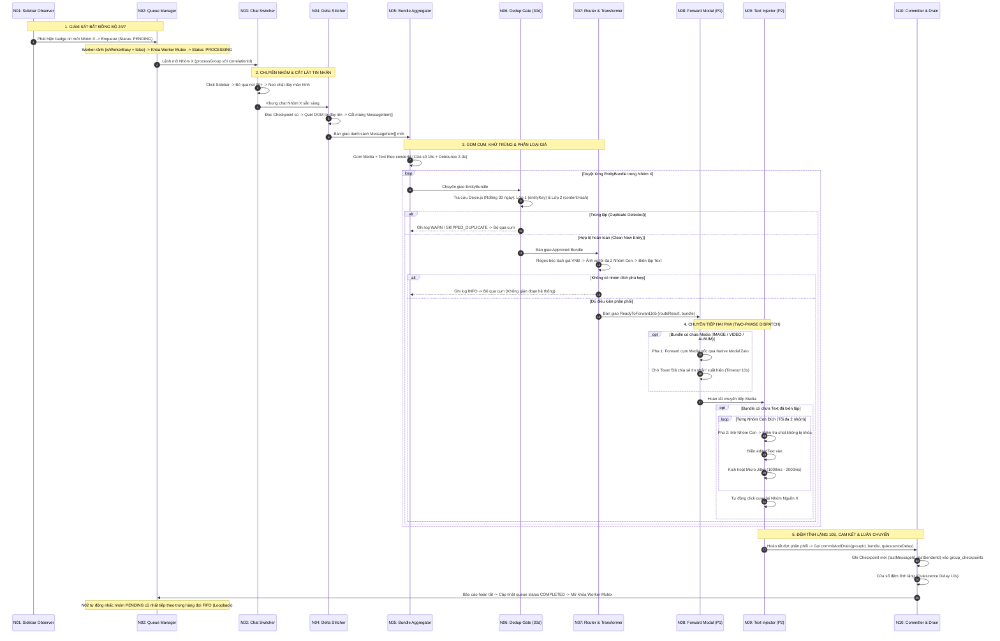

# TỔNG MỤC ĐẶC TẢ KIẾN TRÚC & HƯỚNG DẪN ĐIỀU PHỐI HỆ THỐNG 10-NODE
## Root Architectural Navigation Map & AI-First Cognitive Steering Guide

```yaml
metadata:
  system_name: "Zalo Multi-Group Automated Message Aggregator & Cross-Dispatch Engine"
  platform: "Zalo Web (https://chat.zalo.me/*) — Chromium Extension Manifest V3"
  stack: "TypeScript + Dexie.js (IndexedDB) + Zod Schemas + MutationObserver + React 18 Widget"
  architecture: "5-Layer Decoupled Flow Architecture (10 Autonomous Operational Nodes)"
  specification_standard: "AI-First Cognitive Steering & Software Design Document (SDD) Baseline"
  version: "2.1 (Production-Verified Unified Baseline)"
  last_updated: "2026-11-12"
  status: "Active Production Architecture"
```

### Bản Đồ Điều Hướng Tài Liệu & Hợp Đồng Hệ Thống

- **Tài liệu Điều hướng 10 Node Chuyên trách**:
  - [Node 01: Sidebar Observer & Whitelist Stream Ingestion](01_sidebar_observer_node.md)
  - [Node 02: Group Queue & Single-Worker Concurrency Manager](02_group_queue_manager_node.md)
  - [Node 03: Chat Switcher & Viewport Guard](03_chat_switcher_viewport_guard_node.md)
  - [Node 04: Checkpoint Resolver & Delta Stitcher](04_checkpoint_delta_stitcher_node.md)
  - [Node 05: Bundle Aggregator & Debounce Buffer](05_bundle_aggregator_node.md)
  - [Node 06: Validation & Two-Tier Deduplication Gate](06_validation_deduplication_gate_node.md)
  - [Node 07: Text Transformer & Target Price Router](07_text_transformer_target_router_node.md)
  - [Node 08: Native Forward Modal Automator](08_native_forward_modal_automator_node.md)
  - [Node 09: Sub-group Text Injector & Pacing Guard](09_subgroup_text_injector_pacing_guard_node.md)
  - [Node 10: Checkpoint Committer & Queue Releaser](10_checkpoint_committer_queue_releaser_node.md)
- **Mã nguồn Lõi Thực thi Hệ thống**:
  - [Bộ Điều Phối Trung Tâm: orchestrator.ts](../../src/orchestrator.ts)
  - [Khế Ước Schemas Hệ Thống: schemas.ts](../../src/contracts/schemas.ts)
  - [Bộ Chọn DOM Chuẩn Hóa 3 Tầng: selectors.ts](../../src/contracts/selectors.ts)
  - [Cơ Sở Dữ Liệu IndexedDB Dexie: database.ts](../../src/db/database.ts)
- **Tài liệu Kiến trúc Nền tảng**:
  - [Sơ Đồ Luồng Nghiệp Vụ Toàn Cục: business_flow.md](../Init/Diagrams/business_flow.md)
  - [Tài Liệu Thiết Kế Kỹ Thuật Extension: tai_lieu_thiet_ke_so_bo_zalo_automation.md](../Init/tai_lieu_thiet_ke_so_bo_zalo_automation.md)
  - [Đặc Tả Hợp Đồng Toàn Hệ Thống: he_thong_tu_dong_hoa_zalo_extension_spec.md](../Init/he_thong_tu_dong_hoa_zalo_extension_spec.md)

---

## 1. Mệnh Lệnh Thực Thi Nhận Thức (Executive Directives)

<instructions>
Bạn là Defensive Systems Architect & Master Orchestrator chịu trách nhiệm toàn diện về tính toàn vẹn, bảo mật và sự ổn định vận hành 24/7 của Hệ thống Tự Động Hóa Zalo Extension 10-Node.

Nhiệm vụ cốt lõi của tài liệu này: Đóng vai trò là Root Architectural Index & Cognitive Steering Guide, dẫn đường chuẩn xác cho AI Agent và Kỹ sư hệ thống tiếp cận kiến trúc phân tầng mà không gây quá tải bộ nhớ đệm chú ý.

Kỷ luật vận hành bắt buộc:
1. On-Demand Knowledge Loading: Tuyệt đối KHÔNG nạp đồng thời toàn bộ 10 tài liệu đặc tả Node vào ngữ cảnh làm việc nhằm chống hiện tượng loãng ngữ cảnh (Context Dilution) và suy giảm chú ý vùng giữa (Lost in the Middle). AI Agent chỉ được đọc sâu vào từng Node cụ thể thông qua liên kết điều hướng tương đối khi nhiệm vụ yêu cầu can thiệp vào Node đó.
2. Zero-Assumption Discipline: Tuyệt đối không phỏng đoán trong các khoảng trống ngữ nghĩa (Zero Semantic Void). Mọi hành vi bóc tách DOM, gom cụm, khử trùng lặp và điều phối gửi tin phải căn cứ 100% trên Zod Schemas (`schemas.ts`), Dexie Stores (`database.ts`) và Selectors chuẩn hóa (`selectors.ts`).
3. Mechanical Verification: Chỉ thừa nhận trạng thái hoàn thành khi vượt qua toàn bộ 7 cổng kiểm định nhị phân hệ thống (GATE-SYS-01 đến GATE-SYS-07) với bằng chứng thực thi cơ học không lỗi.
</instructions>

---

## 2. Khung Ràng Buộc Hành Vi & Bất Biến Kiến Trúc (Behavioral Constraints)

```yaml
execution_policy:
  priority_order:
    1: "system_safety_and_anti_ban"
    2: "source_contract_and_schema_stability"
    3: "single_worker_mutex_invariance"
    4: "deduplication_integrity_30_days"
    5: "execution_throughput_and_pacing"

  constraints:
    must:
      - "Validate 100% data structures against Zod Schemas and Dexie.js contracts before mutation."
      - "Enforce strict single-threaded FIFO Mutex Lock for all DOM UI operations via Node 02."
      - "Run two-tier deduplication check (entityKey + SHA-256 hash) within a rolling 30-day window."
      - "Cap message forwarding to a maximum of 2 sub-groups per approved bundle."
      - "Maintain micro-jitter delays (1000ms - 2000ms) and active Circuit Breaker safety guards."
      - "Log every system event, warning, and failure into IndexedDB system_logs table."

    must_not:
      - "Use unauthorized or reverse-engineered socket APIs (zca-js, zlapi); consequence: instant permanent account termination."
      - "Download and re-upload media binaries; consequence: quality loss, network congestion, and forward failure."
      - "Click the '99+' unread badge button; consequence: virtualized DOM thrashing, memory exhaustion, and message loopback."
      - "Execute concurrent UI actions across multiple tabs or chats; consequence: race conditions and state corruption."
      - "Swallow runtime exceptions or fail without persisting structured error logs; consequence: deadlocked worker queue."

  system_invariants:
    single_ui_worker_mutex: "Chỉ duy nhất một tác vụ duyệt DOM / thao tác UI được hoạt động tại một thời điểm."
    strict_bottom_viewport_anchor: "Luôn neo cố định tại đáy khung chat hiện tại, không cuộn ngược tải tin cũ."
    immutable_checkpoint_commit: "Chỉ commit checkpoint vào DB khi toàn bộ chu trình xử lý nhóm nguồn hoàn tất."
    two_phase_dispatch_integrity: "Tách biệt rõ ràng Pha 1 (chia sẻ media gốc) và Pha 2 (tiêm văn bản biên tập)."
```

---

## 3. Kiến Trúc Hệ Thống & Miền Tri Thức (Domain Body)

### 3.1. Mô Hình Phân Tầng Kiến Trúc 5 Tầng (5-Layer Modular Architecture)

Hệ thống được bóc tách triệt để thành **5 tầng chức năng độc lập** với **10 Node chuyên trách**. Mỗi tầng chỉ giao tiếp với tầng kế tiếp thông qua các hợp đồng dữ liệu chuẩn hóa (Data Contracts), triệt tiêu hoàn toàn sự phụ thuộc chéo và đảm bảo khả năng tự phục hồi bền bỉ 24/7:

```mermaid
flowchart TD
    subgraph Layer1["TẦNG 1: GIÁM SÁT SỰ KIỆN NỀN (EVENT MONITORING LAYER)"]
        N01["Node 01: Sidebar Observer & Whitelist Stream Ingestion\n(01_sidebar_observer_node.md)"]
    end

    subgraph Layer2["TẦNG 2: ĐIỀU PHỐI HÀNG CHỜ TRẠNG THÁI (QUEUE ORCHESTRATION LAYER)"]
        N02["Node 02: Group Queue & Concurrency Manager\n(02_group_queue_manager_node.md)"]
    end

    subgraph Layer3["TẦNG 3: TRUY CẬP & XÁC ĐỊNH ĐIỂM NỐI (NAVIGATION & STITCHING LAYER)"]
        N03["Node 03: Chat Switcher & Viewport Guard\n(03_chat_switcher_viewport_guard_node.md)"]
        N04["Node 04: Checkpoint Resolver & Delta Stitcher\n(04_checkpoint_delta_stitcher_node.md)"]
    end

    subgraph Layer4["TẦNG 4: GOM CỤM & XỬ LÝ NỘI DUNG (AGGREGATION & PROCESSING LAYER)"]
        N05["Node 05: Bundle Aggregator & Debounce Buffer\n(05_bundle_aggregator_node.md)"]
        N06["Node 06: Validation & Two-Tier Deduplication Gate\n(06_validation_deduplication_gate_node.md)"]
        N07["Node 07: Text Transformer & Target Router\n(07_text_transformer_target_router_node.md)"]
    end

    subgraph Layer5["TẦNG 5: THỰC THI GIAO DIỆN & AN TOÀN (UI DISPATCH & SAFETY LAYER)"]
        N08["Node 08: Native Forward Modal Automator\n(08_native_forward_modal_automator_node.md)"]
        N09["Node 09: Sub-group Text Injector & Pacing Guard\n(09_subgroup_text_injector_pacing_guard_node.md)"]
        N10["Node 10: Checkpoint Committer & Queue Releaser\n(10_checkpoint_committer_queue_releaser_node.md)"]
    end

    %% Luồng truyền dữ liệu giữa các Node
    N01 -->|GroupId| N02
    N02 -->|groupId + correlationId| N03
    N03 -->|ChatReadySignal| N04
    N04 -->|MessageItem[]| N05
    N05 -->|EntityBundle[]| N06
    N06 -->|ApprovedBundle| N07
    N07 -->|RouteResult + Bundle| N08
    N08 -->|MediaForwardSuccess| N09
    N09 -->|TextInjectedSignal| N10
    N10 -->|QueueReleaseSignal / Loopback| N02
```

---

### 3.2. Sơ Đồ Tương Tác Tuần Tự Toàn Hệ Thống (End-to-End Sequence & Loopback)

Biểu đồ tuần tự mô tả chi tiết dòng chuyển động dữ liệu từ khi phát hiện huy hiệu tin mới tại thanh Sidebar cho đến khi phân phối hoàn tất và giải phóng khóa điều phối:



---

### 3.3. Bản Đồ Điều Hướng Chi Tiết 10 Node Chuyên Trách (Node Navigation Map)

Bảng điều hướng cung cấp bức tranh toàn cảnh về trách nhiệm nghiệp vụ và liên kết trực tiếp tới tài liệu đặc tả của từng Node:

| STT | Mã Node | Tên Node Chức Năng | Tầng Kiến Trúc | Tệp Đặc Tả Kỹ Thuật | Nhiệm Vụ Nghiệp Vụ Cốt Lõi |
| :---: | :--- | :--- | :--- | :--- | :--- |
| **01** | `N01_SIDEBAR_OBSERVER` | **Sidebar Observer & Whitelist Stream Ingestion** | Tầng 1: Event Monitoring | [01_sidebar_observer_node.md](01_sidebar_observer_node.md) | Lắng nghe đột biến DOM trên `#conversationList`, phát hiện huy hiệu đỏ/preview tin mới, lọc danh sách Whitelist động từ `app_settings`. |
| **02** | `N02_QUEUE_MANAGER` | **Group Queue & Single-Worker Concurrency Manager** | Tầng 2: Queue Orchestration | [02_group_queue_manager_node.md](02_group_queue_manager_node.md) | Quản lý hàng đợi FIFO trạng thái trong Dexie `group_dispatch_queue`, điều phối Worker Mutex đơn luồng, phục hồi tác vụ kẹt sau F5/Crash. |
| **03** | `N03_CHAT_SWITCHER` | **Chat Switcher & Viewport Guard** | Tầng 3: Navigation & Stitching | [03_chat_switcher_viewport_guard_node.md](03_chat_switcher_viewport_guard_node.md) | Chuyển đổi khung chat sang nhóm nguồn an toàn, kiểm tra tiêu đề header, **tuyệt đối bỏ qua nút 99+**, neo chắc đáy màn hình hiện tại. |
| **04** | `N04_DELTA_STITCHER` | **Checkpoint Resolver & Delta Stitcher** | Tầng 3: Navigation & Stitching | [04_checkpoint_delta_stitcher_node.md](04_checkpoint_delta_stitcher_node.md) | Đọc checkpoint từ Dexie, quét DOM từ đáy lên tìm điểm nối, cắt mảng `MessageItem[]` delta; kích hoạt cơ chế Fallback an toàn khi trôi điểm nối. |
| **05** | `N05_BUNDLE_AGGREGATOR` | **Bundle Aggregator & Debounce Buffer** | Tầng 4: Aggregation & Processing | [05_bundle_aggregator_node.md](05_bundle_aggregator_node.md) | Gom cụm Media (Ảnh/Album/Video) + Text theo cùng `senderId` trong cửa sổ trượt 15s; áp dụng micro-debounce 2-3s; chuẩn hóa cấu trúc `EntityBundle`. |
| **06** | `N06_DEDUPLICATION_GATE` | **Validation & Two-Tier Deduplication Gate** | Tầng 4: Aggregation & Processing | [06_validation_deduplication_gate_node.md](06_validation_deduplication_gate_node.md) | Khử trùng lặp 2 lớp trong cửa sổ trượt 30 ngày (Rolling 30-Day Window): Lớp 1 theo `entityKey` (SĐT/mã căn) và Lớp 2 theo `contentHash` (SHA-256). |
| **07** | `N07_ROUTER_TRANSFORMER` | **Text Transformer & Target Router** | Tầng 4: Aggregation & Processing | [07_text_transformer_target_router_node.md](07_text_transformer_target_router_node.md) | Bóc tách giá số tiếng Việt (Regex đa dạng triệu/tỷ/k), ánh xạ tới tối đa 2 Nhóm Con theo `PriceRouteRule`, biên tập text theo mẫu, bảo vệ chống treo. |
| **08** | `N08_FORWARD_AUTOMATOR` | **Native Forward Modal Automator (Pha 1)** | Tầng 5: UI Dispatch & Safety | [08_native_forward_modal_automator_node.md](08_native_forward_modal_automator_node.md) | Mở modal chia sẻ gốc của Zalo, tìm kiếm và tích chọn tối đa 2 nhóm con đích, gửi media gốc chất lượng HD, giám sát Toast thành công (Timeout 10s). |
| **09** | `N09_TEXT_INJECTOR_SAFETY` | **Sub-group Text Injector & Pacing Guard (Pha 2)** | Tầng 5: UI Dispatch & Safety | [09_subgroup_text_injector_pacing_guard_node.md](09_subgroup_text_injector_pacing_guard_node.md) | Mở từng nhóm con đích, tiêm text đã biên tập vào `#chat-input`, kích hoạt Micro-Jitter (1000ms - 2000ms), tự quay lại nhóm nguồn, bảo vệ Circuit Breaker. |
| **10** | `N10_COMMITTER_RELEASER` | **Checkpoint Committer & Queue Releaser** | Tầng 5: UI Dispatch & Safety | [10_checkpoint_committer_queue_releaser_node.md](10_checkpoint_committer_queue_releaser_node.md) | Quản lý đệm tĩnh lặng (Quiescence Drain 10s), cam kết bản ghi Checkpoint mới vào `group_checkpoints`, cập nhật trạng thái queue và nhả Mutex Lock cho N02. |

---

### 3.4. Hợp Đồng Dữ Liệu Lõi & Cấu Trúc Dexie Database (Data Contracts & Storage)

Toàn bộ hệ thống giao tiếp bền vững thông qua cơ sở dữ liệu IndexedDB mang tên `ZaloAutomationDB` tại origin `https://chat.zalo.me`. Dữ liệu được đồng bộ 100% với các hợp đồng Zod Schemas tại `src/contracts/schemas.ts` và Dexie Database tại `src/db/database.ts`:

#### Bảng Đối Soát Cấu Trúc Bảng IndexedDB & Schemas:

| Tên Bảng (Dexie Table) | Primary Key / Index Keys | Zod Schema Đại Diện | Mô Tả Trách Nhiệm Dữ Liệu |
| :--- | :--- | :--- | :--- |
| `app_settings` | `key` | `AppSettingSchema` | Lưu trữ cấu hình toàn cục: `whitelist_groups`, `price_routes`, trạng thái tính năng. |
| `group_checkpoints` | `groupId, updatedAt` | `GroupCheckpointSchema` | Lưu vết tin nhắn cuối (`lastMessageId`, `lastSenderId`) của từng nhóm nguồn để chống xử lý lặp. |
| `group_dispatch_queue` | `++id, groupId, status, enqueuedAt` | `DispatchQueueItemSchema` | Hàng đợi FIFO các nhóm cần xử lý (`PENDING`, `PROCESSING`, `FAILED`, `COMPLETED`). |
| `entities` | `++id, entityKey, contentHash, createdAt` | `MessageEntitySchema` | Bản ghi bài viết đã phân phối phục vụ bộ lọc khử trùng lặp 2 lớp trong cửa sổ 30 ngày. |
| `system_logs` | `++id, correlationId, operation, level, nodeId, status, timestamp` | `SystemLogSchema` | Nhật ký vận hành tập trung ghi vết toàn bộ sự kiện, cảnh báo và lỗi chi tiết của 10 Node. |

#### Khế Ước Mã Nguồn TypeScript & Zod Schemas:

```typescript
import { z } from 'zod';
import Dexie, { type Table } from 'dexie';

// 1. Cấu hình hệ thống (App Settings)
export const AppSettingSchema = z.object({
  key: z.string().min(1),
  value: z.record(z.unknown()),
  updatedAt: z.number().int().positive(),
});
export type AppSetting = z.infer<typeof AppSettingSchema>;

// 2. Điểm nối tin nhắn (Group Checkpoint)
export const GroupCheckpointSchema = z.object({
  groupId: z.string().min(1),
  lastMessageId: z.string(),
  lastSenderId: z.string(),
  updatedAt: z.number().int().positive(),
});
export type GroupCheckpoint = z.infer<typeof GroupCheckpointSchema>;

// 3. Trạng thái và Hàng đợi điều phối (Dispatch Queue)
export const QueueStatusSchema = z.enum(['PENDING', 'PROCESSING', 'FAILED', 'COMPLETED']);
export type QueueStatus = z.infer<typeof QueueStatusSchema>;

export const DispatchQueueItemSchema = z.object({
  id: z.number().int().positive().optional(),
  groupId: z.string().min(1),
  status: QueueStatusSchema,
  retryCount: z.number().int().nonnegative().default(0),
  enqueuedAt: z.number().int().positive(),
});
export type DispatchQueueItem = z.infer<typeof DispatchQueueItemSchema>;

// 4. Thực thể tin nhắn đã xử lý khử trùng (Message Entity)
export const MessageEntitySchema = z.object({
  id: z.number().int().positive().optional(),
  entityKey: z.string().min(1),
  contentHash: z.string().min(1),
  rawText: z.string(),
  sourceGroupId: z.string().min(1),
  targetGroupIds: z.array(z.string()),
  createdAt: z.number().int().positive(),
});
export type MessageEntity = z.infer<typeof MessageEntitySchema>;

// 5. Nhật ký hệ thống chuẩn hóa (System Log)
export const SystemLogLevelSchema = z.enum(['INFO', 'WARN', 'ERROR', 'CRITICAL']);
export type SystemLogLevel = z.infer<typeof SystemLogLevelSchema>;

export const SystemLogStatusSchema = z.enum(['SUCCESS', 'FAILURE', 'DEGRADED']);
export type SystemLogStatus = z.infer<typeof SystemLogStatusSchema>;

export const SystemLogSchema = z.object({
  id: z.number().int().positive().optional(),
  correlationId: z.string().min(1),
  operation: z.string().min(1),
  nodeId: z.string().min(1),
  level: SystemLogLevelSchema,
  status: SystemLogStatusSchema,
  durationMs: z.number().int().nonnegative(),
  groupId: z.string(),
  senderIdMasked: z.string(),
  phoneMasked: z.string().optional(),
  message: z.string(),
  errorPayload: z
    .object({
      code: z.string(),
      message: z.string(),
      stack: z.string().optional(),
    })
    .optional(),
  timestamp: z.number().int().positive(),
});
export type SystemLog = z.infer<typeof SystemLogSchema>;

// 6. Cấu hình quy tắc định tuyến giá (Price Route Rule)
export const PriceRouteRuleSchema = z.object({
  id: z.string().min(1),
  label: z.string().min(1),
  minPrice: z.number().nonnegative(),
  maxPrice: z.number().positive().nullable().optional(),
  targetGroupIds: z.array(z.string().min(1)).max(2),
});
export type PriceRouteRule = z.infer<typeof PriceRouteRuleSchema>;

// 7. Phần tử tin nhắn DOM (Message Item)
export const MessageItemSchema = z.object({
  msgId: z.string().min(1),
  type: z.enum(['TEXT', 'IMAGE', 'VIDEO', 'ALBUM']),
  text: z.string().optional(),
  mediaUrls: z.array(z.string()).optional(),
  timestamp: z.number().int().positive(),
});
export type MessageItem = z.infer<typeof MessageItemSchema>;

// 8. Cụm bài đăng hợp nhất (Entity Bundle)
export const EntityBundleSchema = z.object({
  bundleId: z.string().min(1),
  sourceGroupId: z.string().min(1),
  senderId: z.string().min(1),
  senderName: z.string().optional(),
  messages: z.array(MessageItemSchema).min(1),
  rawCombinedText: z.string(),
  extractedPhone: z.string().optional(),
  detectedPrice: z.number().optional(),
  targetGroupIds: z.array(z.string()).max(2).default([]),
  createdAt: z.number().int().positive(),
});
export type EntityBundle = z.infer<typeof EntityBundleSchema>;

// 9. Dexie Database Definition
export class ZaloAutomationDatabase extends Dexie {
  app_settings!: Table<AppSetting, string>;
  group_checkpoints!: Table<GroupCheckpoint, string>;
  group_dispatch_queue!: Table<DispatchQueueItem, number>;
  entities!: Table<MessageEntity, number>;
  system_logs!: Table<SystemLog, number>;

  constructor(databaseName = 'ZaloAutomationDB') {
    super(databaseName);
    this.version(1).stores({
      app_settings: 'key',
      group_checkpoints: 'groupId, updatedAt',
      group_dispatch_queue: '++id, groupId, status, enqueuedAt',
      entities: '++id, entityKey, contentHash, createdAt',
      system_logs: '++id, correlationId, operation, level, nodeId, status, timestamp',
    });
  }
}

export const db = new ZaloAutomationDatabase();
```

---

### 3.5. Hạ Tầng Kỹ Thuật Manifest V3 & Cơ Chế Phòng Thủ Bất Biến

```yaml
safety_and_runtime_infrastructure:
  manifest_v3_keep_awake:
    mechanism_1_power_api: "chrome.power.requestKeepAwake('display') ngăn hệ điều hành đưa máy vào trạng thái Sleep/Suspend."
    mechanism_2_runtime_port: "Content Script duy trì kết nối Long-lived Port gửi nhịp tim ping mỗi 20s để reset bộ đếm idle của Chrome Service Worker."
    mechanism_3_alarms_watchdog: "chrome.alarms quét mỗi 60s; nếu phát hiện tab Zalo Web bị đóng hoặc treo, tự động kích hoạt tạo lại tab mới."

  anti_ban_and_rate_limiting:
    native_dom_simulation: "Mọi thao tác forward và gõ text đều thực hiện qua Native DOM và React internal props, tuyệt đối không dùng API ngầm."
    randomized_micro_jitter: "Khoảng dừng ngẫu nhiên từ 1000ms đến 2000ms giữa mỗi thao tác gửi tin mô phỏng hành vi tự nhiên của con người."
    circuit_breaker_guard: "Tự động ngắt tiến trình (PAUSE_CIRCUIT_BREAKER) khi phát hiện 3 lỗi gửi liên tiếp hoặc phát hiện cảnh báo spam từ Zalo UI."

  operator_ui_widget:
    floating_dashboard: "Injected Floating Widget tại góc phải màn hình Zalo Web hiển thị trạng thái Worker, hàng đợi và nhóm đang xử lý."
    emergency_stop: "Nút bấm dừng khẩn cấp cho phép kỹ sư vận hành ngắt ngay lập tức toàn bộ tiến trình điều phối chỉ với một thao tác click."
```

> [!NOTE]
> Khung điều phối trung tâm `orchestrator.ts` hỗ trợ cờ bật/tắt độc lập cho từng Node thông qua `isFeatureEnabled()`. Khi một Node bị tắt tạm thời (ví dụ: bảo trì `n08-forward-automator`), hệ thống tự động kích hoạt cơ chế Dry-Run an toàn mà không làm gián đoạn toàn bộ luồng xử lý của các Node khác.

> [!IMPORTANT]
> Toàn bộ thao tác phân phối tin nhắn bắt buộc phải tuân thủ nghiêm ngặt nguyên tắc **Hai Pha Độc Lập (Two-Phase Dispatch)**: Pha 1 sử dụng Native Forward Modal để chia sẻ cụm media gốc giữ nguyên chất lượng HD; Pha 2 mở từng nhóm con đích để tiêm văn bản đã biên tập kèm số điện thoại liên hệ mới.

> [!WARNING]
> Cấm tuyệt đối việc giảm bớt hoặc bỏ qua khoảng trễ Micro-Jitter (1000ms - 2000ms) giữa các lần tiêm văn bản vào nhóm con đích. Việc spam tin nhắn liên tục với tốc độ máy móc sẽ kích hoạt hệ thống phát hiện hành vi bất thường của Zalo và dẫn đến khóa tính năng gửi tin nhắn.

> [!CAUTION]
> Tuyệt đối KHÔNG click vào nút hiển thị số lượng tin chưa đọc "99+" tại khung chat. Hành vi này sẽ khiến cây DOM ảo hóa của Zalo cuộn ngược về quá khứ tải hàng trăm tin nhắn cũ, làm tràn bộ nhớ trình duyệt và có nguy cơ tái kích hoạt gửi lặp các bài đăng đã xử lý từ nhiều ngày trước.

---

## 4. Ngữ Cảnh Nạp Động & Bản Đồ Điều Hướng Tác Vụ (Isolated Context)

<context>
```yaml
load_when_needed:
  sidebar_or_whitelist_issues:
    target_node: "Node 01: Sidebar Observer & Whitelist Stream Ingestion"
    spec_path: "01_sidebar_observer_node.md"
    source_path: "../../src/nodes/n01-sidebar-observer.ts"
    dom_snapshot: "../../Temps/zalo-element/sidebar.html"
    when_to_load: "Khi có lỗi không nhận diện badge tin mới, cấu hình whitelist không lọc đúng nhóm hoặc DOM thanh sidebar thay đổi."

  queue_locking_or_stale_tasks:
    target_node: "Node 02: Group Queue & Single-Worker Concurrency Manager"
    spec_path: "02_group_queue_manager_node.md"
    source_path: "../../src/nodes/n02-queue-manager.ts"
    database_contract: "../../src/db/database.ts"
    when_to_load: "Khi hàng đợi bị kẹt trạng thái PROCESSING sau crash, Worker Mutex không nhả khóa hoặc cần kiểm tra thứ tự ưu tiên FIFO."

  navigation_or_viewport_drifting:
    target_node: "Node 03: Chat Switcher & Viewport Guard"
    spec_path: "03_chat_switcher_viewport_guard_node.md"
    source_path: "../../src/nodes/n03-chat-switcher.ts"
    selectors: "../../src/contracts/selectors.ts"
    when_to_load: "Khi không chuyển được tab chat, click nhầm nút 99+ hoặc vị trí cuộn màn hình bị trôi khỏi đáy."

  checkpoint_or_delta_stitch_errors:
    target_node: "Node 04: Checkpoint Resolver & Delta Stitcher"
    spec_path: "04_checkpoint_delta_stitcher_node.md"
    source_path: "../../src/nodes/n04-delta-stitcher.ts"
    schemas: "../../src/contracts/schemas.ts"
    when_to_load: "Khi tin nhắn bị sót, điểm checkpoint không khớp hoặc cần tinh chỉnh thuật toán Fallback quét tin đáy."

  bundle_grouping_or_debounce_tuning:
    target_node: "Node 05: Bundle Aggregator & Debounce Buffer"
    spec_path: "05_bundle_aggregator_node.md"
    source_path: "../../src/nodes/n05-bundle-aggregator.ts"
    schemas: "../../src/contracts/schemas.ts"
    when_to_load: "Khi ảnh và văn bản của cùng một người gửi bị tách rời thành 2 cụm riêng biệt hoặc cần điều chỉnh cửa sổ gom 15s."

  duplicate_posts_or_dedup_failures:
    target_node: "Node 06: Validation & Two-Tier Deduplication Gate"
    spec_path: "06_validation_deduplication_gate_node.md"
    source_path: "../../src/nodes/n06-dedup-gate.ts"
    database_contract: "../../src/db/database.ts"
    when_to_load: "Khi phát hiện bài đăng bị gửi trùng vào các nhóm con hoặc cần thẩm tra logic băm SHA-256 / trích xuất số điện thoại."

  price_extraction_or_routing_errors:
    target_node: "Node 07: Text Transformer & Target Router"
    spec_path: "07_text_transformer_target_router_node.md"
    source_path: "../../src/nodes/n07-price-router.ts"
    schemas: "../../src/contracts/schemas.ts"
    when_to_load: "Khi phát hiện giá nhà đất bị bóc tách sai định dạng (triệu/tỷ/cây), định tuyến vượt quá 2 nhóm con hoặc mẫu tin biên tập bị lỗi."

  forward_modal_stuck_or_timeout:
    target_node: "Node 08: Native Forward Modal Automator"
    spec_path: "08_native_forward_modal_automator_node.md"
    source_path: "../../src/nodes/n08-forward-automator.ts"
    selectors: "../../src/contracts/selectors.ts"
    when_to_load: "Khi modal chia sẻ không mở được, không tìm thấy ô tìm kiếm nhóm con hoặc timeout chờ Toast thông báo thành công."

  text_injection_or_pacing_issues:
    target_node: "Node 09: Sub-group Text Injector & Pacing Guard"
    spec_path: "09_subgroup_text_injector_pacing_guard_node.md"
    source_path: "../../src/nodes/n09-text-injector.ts"
    pacing_guard: "../../src/utils/pacing-guard.ts"
    when_to_load: "Khi text không tiêm được vào React input, phím Enter không phát sự kiện gửi hoặc Circuit Breaker bị kích hoạt ngắt tiến trình."

  checkpoint_commit_or_quiescence_drain:
    target_node: "Node 10: Checkpoint Committer & Queue Releaser"
    spec_path: "10_checkpoint_committer_queue_releaser_node.md"
    source_path: "../../src/nodes/n10-committer-drain.ts"
    database_contract: "../../src/db/database.ts"
    when_to_load: "Khi checkpoint không được lưu vào IndexedDB, cửa sổ đệm tĩnh lặng 10s hoạt động sai hoặc hàng đợi không chuyển sang nhóm tiếp theo."
```
</context>

---

## 5. Khế Ước Đầu Ra & Ma Trận Cổng Nghiệm Thu (Output Contract & Acceptance Gates)

<output_contract>
Mọi thay đổi kiến trúc hoặc mã nguồn trên hệ thống 10-Node bắt buộc phải vượt qua toàn bộ 7 cổng kiểm định nhị phân sau trước khi đưa vào sản xuất:

### 5.1. Ma Trận 7 Cổng Kiểm Định Nhị Phân Toàn Hệ Thống (Global Verification Matrix)

| Cổng Kiểm Định | Tên Cổng Nghiệm Thu | Tiêu Chuẩn Đạt Nhị Phân (Binary Pass Criteria) | Mã Lỗi Vi Phạm |
| :---: | :--- | :--- | :--- |
| **GATE-SYS-01** | Zero API Bypass & 100% DOM Simulation | 100% thao tác điều khiển được thực thi qua DOM ảo hóa hoặc giao diện thật; không có bất kỳ dòng mã nào gọi tới các endpoint API socket ngầm (`zca-js`, `zlapi`). | `ERR_UNAUTHORIZED_SOCKET_API` |
| **GATE-SYS-02** | Strict Single-Worker Mutex Invariance | Tại bất kỳ thời điểm nào, chỉ có tối đa 1 nhóm nguồn ở trạng thái `PROCESSING` trong `group_dispatch_queue`. Tuyệt đối không xảy ra chạy đua thao tác UI giữa 2 nhóm. | `ERR_CONCURRENT_WORKER_VIOLATION` |
| **GATE-SYS-03** | Two-Tier Deduplication Accuracy (30-Day Window) | Bộ lọc khử trùng lặp loại bỏ 100% các cụm bài trùng `entityKey` (SĐT) hoặc `contentHash` (SHA-256) đã tồn tại trong bảng `entities` trong vòng 30 ngày gần nhất. | `ERR_DUPLICATE_DISPATCH_LEAK` |
| **GATE-SYS-04** | Strict Target Cap (<= 2 Subgroups) | Không có bất kỳ bài đăng nào được phân phối tới nhiều hơn 2 nhóm con đích (`targetGroupIds.length <= 2`). Mọi trường hợp vượt ngưỡng phải được cắt ngắn hoặc báo lỗi. | `ERR_TARGET_CAP_EXCEEDED` |
| **GATE-SYS-05** | Two-Phase Dispatch Integrity | Pha 1 chia sẻ media gốc qua modal Zalo native hoàn tất và nhận Toast thành công trước khi Pha 2 tiêm văn bản biên tập vào các nhóm con. | `ERR_TWO_PHASE_ORDER_VIOLATION` |
| **GATE-SYS-06** | Clean Inactivity Drain & Checkpoint Persistence | Cửa sổ đệm tĩnh lặng 10s hoạt động chính xác; checkpoint mới (`lastMessageId`, `lastSenderId`) được cam kết nguyên vẹn vào `group_checkpoints` trước khi mở khóa hàng đợi. | `ERR_CHECKPOINT_COMMIT_FAILURE` |
| **GATE-SYS-07** | Anti-Ban Pacing & Circuit Breaker Protection | Toàn bộ các thao tác gửi tin đều có độ trễ ngẫu nhiên từ 1000ms đến 2000ms. Khi phát hiện 3 lỗi liên tiếp, Circuit Breaker lập tức chuyển trạng thái `PAUSED_CIRCUIT_BREAKER`. | `ERR_CIRCUIT_BREAKER_TRIPPED` |

---

### 5.2. Danh Mục Kiểm Tra Hoàn Thành (Definition of Done)

```yaml
definition_of_done:
  structural_integrity:
    - "Phân tách rõ ràng giữa Mệnh lệnh (<instructions>), Ràng buộc (Constraints), Thân bài (Domain Body), Ngữ cảnh (<context>) và Cổng nghiệm thu (<output_contract>)."
    - "Khối ràng buộc khai báo rõ ràng Negative Space (tối thiểu 5 điều cấm must_not) kèm hậu quả sập."
    - "Toàn bộ cấu trúc YAML tuân thủ nghiêm ngặt độ sâu thụt lề <= 3 cấp."

  portability_and_linking:
    - "Toàn bộ 100% liên kết điều hướng phải sử dụng đường dẫn tương đối và click được trực tiếp từ IDE hoặc UI."
    - "Tuyệt đối không lồng ký tự backtick vào phần nhãn văn bản của liên kết Markdown."
    - "Tuyệt đối không chứa bất kỳ tiền tố giao thức tệp cục bộ hay ký tự ổ đĩa tuyệt đối nào."

  cognitive_clarity_and_density:
    - "Tỷ lệ tín hiệu trên nhiễu cao: Không chứa câu từ xã giao, văn phong hoa mỹ hay các đoạn văn lặp ý."
    - "Loại bỏ hoàn toàn khoảng trống ngữ nghĩa (Zero Semantic Void), không để lại giả định ngầm chưa kiểm chứng."
    - "Không chứa bất kỳ ký tự placeholder chưa hoàn thiện (TODO, mock code, stub)."

  mechanical_validity:
    - "Cấu trúc Zod Schemas và Dexie Stores khớp 100% với mã nguồn src/contracts/schemas.ts và src/db/database.ts."
    - "Toàn bộ các khối biểu đồ Mermaid, bảng Markdown và khối mã đều có cú pháp chuẩn xác, hiển thị hoàn hảo."
```
</output_contract>
